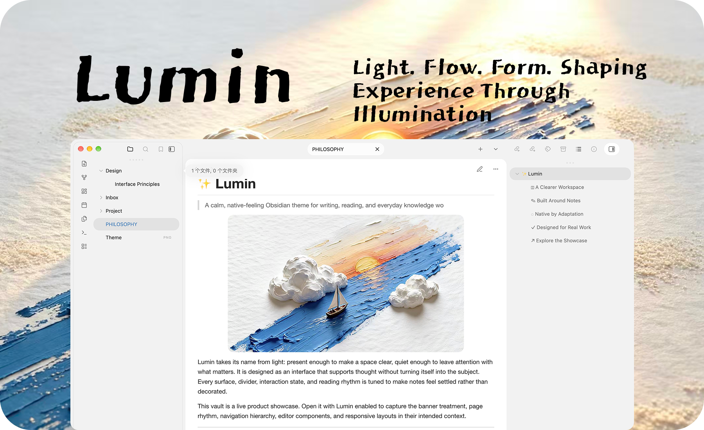
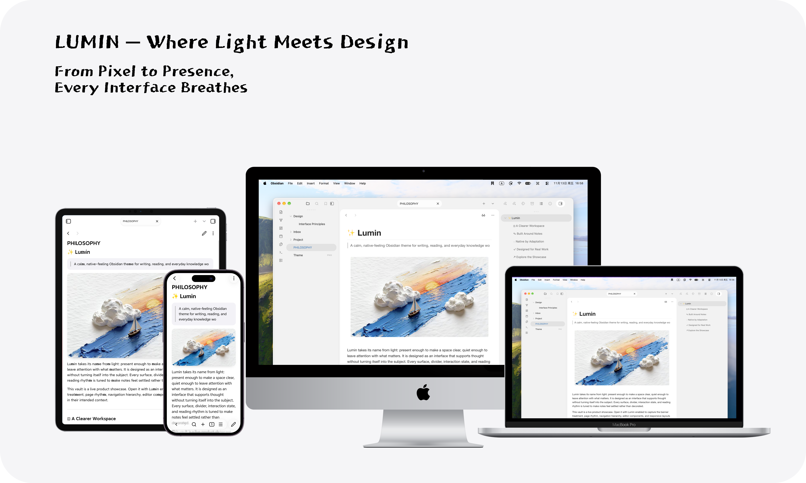
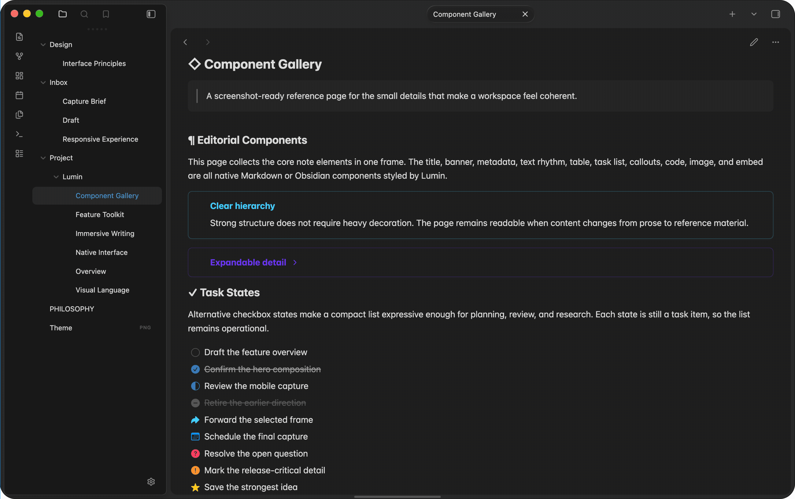
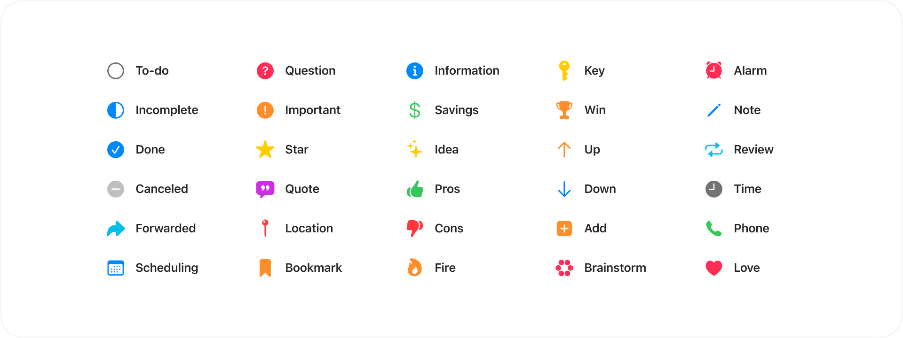

<h1 align="center">Lumin</h1>

<p align="center">A calm, native-feeling Obsidian theme for focused writing and everyday knowledge work.</p>

<p align="center">
  <a href="https://community.obsidian.md/themes/lumin"></a>
  <a href="https://ko-fi.com/yixuanhq"></a>
</p>

<p align="center">
  
  
  
</p>

<p align="center"><a href="README_CN.md">简体中文</a></p>



Lumin keeps the note at the center of the workspace. Its measured spacing, clear hierarchy, and platform-aware details make long writing sessions feel quieter without hiding the tools that support them.

## Highlights

- **Content-first workspace.** Comfortable reading width, refined typography, and deliberate hierarchy for writing, review, and reference.
- **A complete note surface.** Thoughtful styling for properties, tables, callouts, code, tasks, embeds, banners, images, and media.
- **Desktop controls when you need them.** Hoverable ribbons and sidebars, focus view, compact panel actions, and centered tabs keep wide workspaces adaptable.
- **Configure without CSS.** Optional [Style Settings](https://github.com/mgmeyers/obsidian-style-settings) controls cover color, editor, desktop behavior, and accessibility preferences.
- **Typora-inspired writing details.** Readable code with brown comments, compact lists, gently rounded tables, and a standalone Windows/macOS hotkey importer.

## Across Devices

Lumin shares one visual language across every Obsidian platform while adapting density, navigation, safe-area spacing, and touch targets to the device.

| Platform | Lumin adapts |
| --- | --- |
| macOS, Windows, Linux | Window-aware surfaces, tabs, sidebars, and desktop interactions |
| iPad and Android tablets | Touch-sized controls, flexible drawers, and tablet settings layouts |
| iPhone and Android phones | Safe-area-aware navigation, sheets, drawers, and mobile controls |



## Note Details

The theme makes everyday note components easier to scan without turning them into separate visual systems.



Alternative checkbox states add a compact vocabulary for tasks while preserving standard Obsidian task behavior.



### Task States

Use Obsidian task syntax to give a task a more specific state. Lumin preserves the meaning of standard tasks and adds a distinct icon or treatment for the following commonly used states.

| Syntax | State |
| --- | --- |
| `- [ ]` | To-do |
| `- [/]` | In progress |
| `- [x]` | Done |
| `- [-]` | Canceled |
| `- [>]` | Forwarded |
| `- [<]` | Scheduled |
| `- [?]` | Question |
| `- [!]` | Important |
| `- [*]` | Starred |
| `- [I]` | Idea |
| `- [p]` / `- [c]` | Pros / cons |

Additional symbols cover quotation, location, bookmark, information, savings, key, win, time, telephone, love, and other task states.

## Install

### From Obsidian

1. Open **Settings > Appearance > Themes**.
2. Select **Manage**, search for **Lumin**, then install and enable it.

### Manual Install

1. Download `manifest.json` and `theme.css` from the [latest release](https://github.com/yixuan-space/obsidian-lumin/releases).
2. Create `.obsidian/themes/Lumin/` in your vault.
3. Put both files in that directory.
4. In **Settings > Appearance > Themes**, select **Lumin**.

## Customize

Note typography takes inspiration from Typora's GitHub theme: a cross-platform sans-serif stack, monospace code, and subtle rules under first- and second-level headings. Code uses neutral gray backgrounds, deep purple keywords, brick-red strings, and brown comments with a matching dark palette. Tables and code blocks have 8px corners; tables retain clear grids, alternating rows, and stable headers on hover. Font choices in Obsidian's Appearance settings still take priority; no fonts are downloaded or bundled.

Ordered and unordered lists use clearer markers and compact spacing. Reading view uses a consistent 1.875em indent per level (30px at a 16px text size), including mixed nested lists, with space between paragraphs within an item. The editor retains Obsidian's native indentation, numbering, and folding behavior.

Ordinary blockquotes use a transparent background, a 4px rule, and simple spacing. Horizontal rules, highlights, keyboard keys, and footnote backlinks use compact, readable styling.

### Typora-style hotkeys

The hotkey tool is separate from the theme; installing Lumin does not change your bindings. Open [`tools/typora-hotkeys`](tools/typora-hotkeys) and choose the entry point for your system:

Download `typora-hotkeys.zip` from the [1.2.0 release](https://github.com/yixuan-space/obsidian-lumin/releases/tag/1.2.0) for the standalone tool, or download the full repository. See the [1.2.0 release notes](docs/releases/1.2.0.md).

| System | Entry point | Interface |
| --- | --- | --- |
| Windows 10/11 | Double-click [`Start.cmd`](tools/typora-hotkeys/Start.cmd) | A window for vault selection, preview, import, and restore |
| macOS (Apple Silicon / Intel) | Double-click [`Start.command`](tools/typora-hotkeys/Start.command) | Native dialogs with results in Terminal |
| Linux / command line | `node import-hotkeys.mjs --vault "/path/to/vault"` | Preview by default; add `--apply` to write |

1. Clone the repository or use GitHub **Code → Download ZIP**, then extract it. Keep the entire `tools/typora-hotkeys` folder together.
2. Install **Node.js 22 or a newer LTS release**. No npm dependencies or community plugins are required for the importer.
3. Fully quit Obsidian (Command+Q on Mac), open the launcher, and select a vault. Preview the changes before importing if desired.

The profile covers headings, body text, bold, italics, strikethrough, code, quotes, lists, links, tables, and source mode. `Mod` becomes Ctrl on Windows/Linux and Command on Mac. Imports back up existing changes, detect custom conflicts, preserve unrelated bindings, and support restoration. Some Obsidian default shortcuts are disabled to avoid conflicts. This is a shared Typora Windows/Linux-style layout, not an exact replica of Typora's macOS shortcuts.

Copy the tool folder to another computer, or sync `.obsidian/hotkeys.json` for a shared vault using Obsidian Sync's hotkey settings or another sync tool. Import separately for different vaults. Mobile devices can receive synced bindings for supported external-keyboard commands. On Mac, a downloaded launcher may need executable permission (`chmod +x Start.command`) or approval through Control-click → Open / System Settings → Privacy & Security. See the [tool guide (Chinese)](tools/typora-hotkeys/README.md) and [full mapping and sync guide (Chinese)](docs/typora-hotkeys.zh-CN.md).

Lumin works without companion plugins. Install and enable [Style Settings](https://github.com/mgmeyers/obsidian-style-settings) to adjust Lumin in **Settings > Style Settings**.

- Choose the default, mist blue, moss green, or warm gray palette in light and dark appearance.
- Tune desktop behavior, including hover ribbons, hover sidebars, focus view, tab alignment, compact panel actions, and media zoom.
- Adjust reading width, block and media width, banner treatment, active-line highlight, link underlines, and image alignment.
- Reduce motion, soften unfocused contrast changes, or adjust interface and icon sizing.

## Per-Note Layouts

Use the `cssclasses` property in a note's frontmatter to change the layout of that note without affecting the rest of the vault.

```yaml
---
cssclasses:
  - cards
  - cards-16-9
  - cards-cols-3
  - table-wide
---
```

| Classes | Effect |
| --- | --- |
| `cards`, `list-cards` | Display Dataview tables or lists as cards |
| `cards-cover`, `cards-16-9`, `cards-1-1`, `cards-2-1`, `cards-2-3` | Control card image fit and aspect ratio |
| `cards-cols-1` through `cards-cols-8` | Set a card grid's column count |
| `table-wide`, `table-max`, `table-100` | Expand tables and Dataview blocks beyond the reading column |
| `img-wide`, `img-max`, `img-100` | Expand images and embeds |
| `bases-wide`, `bases-max`, `bases-100` | Expand Obsidian Bases views |
| `table-small`, `table-tiny`, `table-nowrap`, `table-numbers`, `row-lines`, `col-lines` | Refine table density, wrapping, numbering, and dividers |

## Integrations

Lumin includes dedicated styling for Obsidian properties, Bases, tables, callouts, banners, embeds, and task states. It also styles Dataview tables and card layouts, supports block-width utilities for Datacore blocks, and handles banner areas used by banner-style plugins.

## Compatibility

Lumin requires Obsidian `1.11.6` or later. It supports light and dark appearance on macOS, Windows, Linux, Android, and iOS. Platform-specific behavior follows Obsidian's native device and window classes where available.

Lumin is intentionally content-first and close to Obsidian's native interaction model. CSS snippets that substantially replace the workspace layout may need adjustment when used with the theme.

## Feedback

For bugs and feature requests, please search existing [issues](https://github.com/yixuan-space/obsidian-lumin/issues) first, then open a new issue using the relevant template. Include your Obsidian version, operating system, and any enabled CSS snippets or plugins that affect the affected view.

## Development

Source styles live in `src/`; the root `theme.css` is the distributable file. Rebuild it after SCSS changes with Node.js available:

```bash
npx --yes sass src/theme.scss theme.css --no-source-map
```

Commit the generated `theme.css` with its source changes. Run `git diff --check` before opening a pull request or publishing a release.

Install development dependencies with `npm ci`. Use `npm run build`, `npm run verify:edge`, and `npm run test:hotkeys` to build and verify the theme and importer. Browser checks use locally installed Microsoft Edge with an isolated temporary session, covering all palettes, light/dark modes, desktop/mobile widths, and print styles. Set `EDGE_PATH` for a nonstandard installation. Checks do not change the system default browser or use your personal browser profile. This project does not use Tabbit for verification.

## Credits

Lumin is based on [Cupertino](https://github.com/aaaaalexis/obsidian-cupertino). It includes MIT-licensed snippets from [Minimal](https://github.com/kepano/obsidian-minimal) and public-domain references from [Alternative Checkboxes Reference Set](https://github.com/damiankorcz/Alternative-Checkboxes-Reference-Set). See [third-party notices](THIRD_PARTY_NOTICES.md) for the applicable attribution and terms.

Craft is a visual reference only; this repository does not redistribute its code or assets.

## License

YiXuan's original Lumin contributions are released under the [MIT License](LICENSE). Included third-party material remains under its own terms in [third-party notices](THIRD_PARTY_NOTICES.md).
