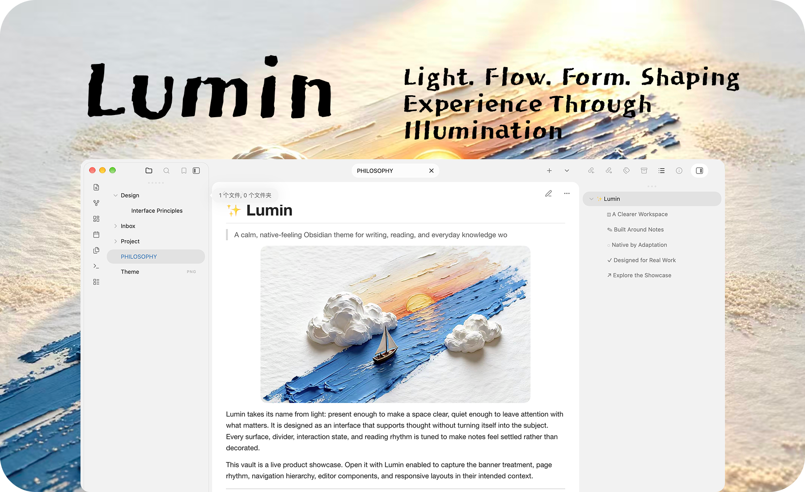
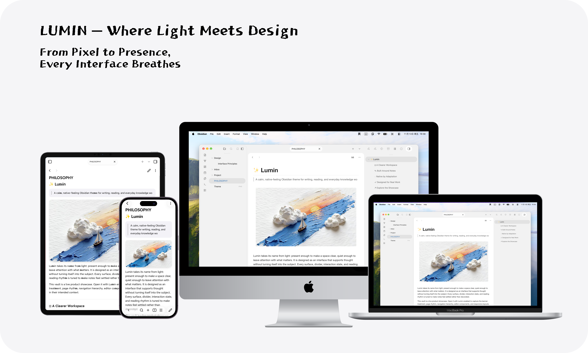
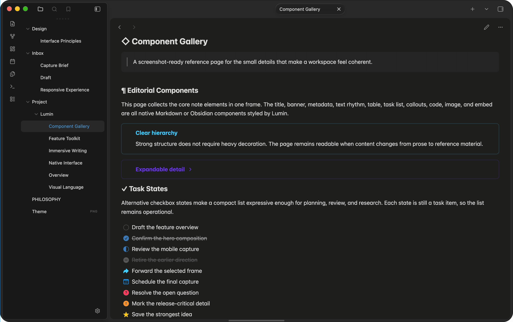
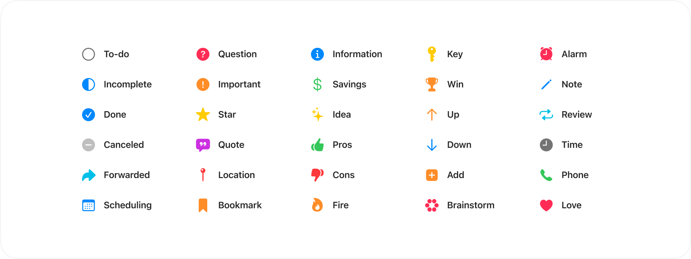

<h1 align="center">Lumin</h1>

<p align="center">一款为专注写作和日常知识管理打造的安静、清透且具有原生感的 Obsidian 主题。</p>

<p align="center">
  <a href="https://community.obsidian.md/themes/lumin"></a>
  <a href="https://ko-fi.com/yixuanhq"></a>
</p>

<p align="center">
  
  
  
</p>

<p align="center"><a href="README.md">English</a></p>



Lumin 让笔记始终位于工作区的视觉中心。清晰的层级、克制的留白和贴合平台的细节，让长时间写作更专注，也不牺牲笔记周边的操作效率。

## 亮点

- **以内容为先的工作区。** 舒适的阅读宽度、经过调整的排版与明确的层级，适合写作、复盘和查阅。
- **完整的笔记表面。** 元数据、表格、Callout、代码、任务、嵌入、Banner、图片和媒体均有统一而克制的样式。
- **需要时才出现的桌面控件。** 悬停功能区和侧边栏、专注视图、紧凑面板操作区与居中标签，使宽屏工作区保持灵活。
- **无需编写 CSS 也可自定义。** 可选的 [Style Settings](https://github.com/mgmeyers/obsidian-style-settings) 提供配色、编辑器、桌面行为和辅助功能选项。
- **Typora 风格的写作细节。** 清晰的代码与棕褐注释、紧凑列表、小圆角表格，并提供可独立使用的 Windows/macOS 快捷键导入工具。

## 跨设备体验

Lumin 在所有 Obsidian 平台上延续同一套视觉语言，同时根据设备调整密度、导航、安全区和触控尺寸。

| 平台 | Lumin 的适配方式 |
| --- | --- |
| macOS、Windows、Linux | 感知窗口状态的表面、标签、侧边栏与桌面交互 |
| iPad 和 Android 平板 | 触控尺寸、灵活抽屉与适合平板的设置布局 |
| iPhone 和 Android 手机 | 感知安全区的导航、底部面板、抽屉和移动控件 |



## 为笔记细节而设计

主题让每天都会用到的笔记组件更容易浏览，同时保持一致的视觉系统。



替代复选框为任务状态提供紧凑、清晰的表达，同时保留标准 Obsidian 任务项的行为。



### 任务状态

使用 Obsidian 的任务语法为任务标记更具体的状态。Lumin 保留标准任务的语义，并为下列常用状态提供不同的图标或视觉处理。

| 语法 | 状态 |
| --- | --- |
| `- [ ]` | 待办 |
| `- [/]` | 进行中 |
| `- [x]` | 已完成 |
| `- [-]` | 已取消 |
| `- [>]` | 已转交 |
| `- [<]` | 已安排 |
| `- [?]` | 疑问 |
| `- [!]` | 重要 |
| `- [*]` | 星标 |
| `- [I]` | 想法 |
| `- [p]` / `- [c]` | 优点 / 缺点 |

此外还支持引用、地点、书签、信息、储蓄、钥匙、胜利、时间、电话、喜爱等任务状态。

## 安装

### 通过 Obsidian 安装

1. 打开“设置 > 外观 > 主题”。
2. 点击“管理”，搜索 **Lumin**，然后安装并启用主题。

### 手动安装

1. 从[最新发布版本](https://github.com/yixuan-space/obsidian-lumin/releases)下载 `manifest.json` 和 `theme.css`。
2. 在 Vault 中创建 `.obsidian/themes/Lumin/`。
3. 将两个文件放入该目录。
4. 在“设置 > 外观 > 主题”中选择 **Lumin**。

## 自定义

笔记排版参考 Typora GitHub 主题：正文采用跨平台无衬线字体回退，代码采用等宽字体，一级与二级标题带细分隔线。代码配色使用中性灰底色、深紫关键字、砖红字符串和棕褐注释，并适配深色外观。表格与代码块采用 8px 圆角，表格保留清晰网格、交替行底色及稳定的表头悬停效果。Obsidian 外观设置中的正文字体和等宽字体选择仍优先生效；主题不会下载或附带字体。

有序与无序列表使用更清晰的标记和紧凑间距。阅读视图中每级缩进为 1.875em（16px 正文下为 30px），混合嵌套列表采用相同缩进，列表内多段文字保留适度间距；编辑视图保留 Obsidian 的原生缩进、编号和折叠行为。

普通引用使用透明背景、4px 竖线与简洁留白；分隔线、高亮文字、键盘按键和脚注返回链接也采用更紧凑、清晰的样式。

### Typora 风格快捷键

快捷键工具与主题独立，安装主题不会自动改动你的键位。打开仓库中的 [`tools/typora-hotkeys`](tools/typora-hotkeys) 文件夹，按系统选择入口：

从 [1.2.0 发布页](https://github.com/yixuan-space/obsidian-lumin/releases/tag/1.2.0)下载 `typora-hotkeys.zip` 即可单独获取工具，也可以下载整个仓库。[查看 1.2.0 更新说明](docs/releases/1.2.0.md)。

| 系统 | 双击入口 | 操作方式 |
| --- | --- | --- |
| Windows 10/11 | [`Start.cmd`](tools/typora-hotkeys/Start.cmd) | 窗口选择笔记库，点击预览、导入或恢复 |
| macOS（Apple Silicon / Intel） | [`Start.command`](tools/typora-hotkeys/Start.command) | 系统对话框选择笔记库与操作，终端显示结果 |
| Linux / 命令行 | `node import-hotkeys.mjs --vault "/path/to/vault"` | 默认预览，加 `--apply` 后写入 |

1. 通过 Git 克隆仓库，或在 GitHub 点击 **Code → Download ZIP** 后解压；请保留整个 `tools/typora-hotkeys` 文件夹，不要只下载启动文件。
2. 安装 **Node.js 22 或更新的 LTS 版本**，无需安装 npm 依赖或社区插件。
3. 完全退出 Obsidian（Mac 使用 Command+Q），双击对应入口并选择笔记库；可先预览改动，再导入。

包含标题、正文、加粗、斜体、删除线、代码、引用、列表、链接、表格、源码切换等常用键位。`Mod` 自动对应 Windows/Linux 的 Ctrl 与 Mac 的 Command。写入前自动备份，支持恢复、冲突检测和保留其他自定义绑定。部分 Obsidian 原生键位会让位给 Typora 风格配置，完整映射与差异见[快捷键与多设备同步说明](docs/typora-hotkeys.zh-CN.md)。

整个工具文件夹可以复制到其他电脑。同 Vault 可通过 Obsidian Sync 的快捷键设置同步；其他同步方式须包含 `.obsidian/hotkeys.json`。不同 Vault 分别导入一次，手机和平板可同步配置并配合外接键盘使用。Mac 首次下载若提示权限或来源限制，参见[工具说明](tools/typora-hotkeys/README.md#mac-首次打开)。

不安装附加插件也可完整使用 Lumin。安装并启用 [Style Settings](https://github.com/mgmeyers/obsidian-style-settings) 后，可在“设置 > Style Settings”中调整主题。

- 在默认、雾蓝、苔绿和暖灰配色之间选择，并同步适配浅色与深色外观。
- 调整悬停功能区、悬停侧边栏、专注视图、标签对齐、紧凑面板操作区和媒体缩放等桌面行为。
- 设置阅读宽度、块级与媒体宽度、Banner 样式、当前行高亮、链接下划线和图片对齐。
- 减少动态效果、减弱失焦对比变化，或微调界面和图标尺寸。

## 单篇笔记布局

通过笔记 frontmatter 中的 `cssclasses` 属性，可以只改变当前笔记的布局，不影响整个 Vault。

```yaml
---
cssclasses:
  - cards
  - cards-16-9
  - cards-cols-3
  - table-wide
---
```

| 类名 | 效果 |
| --- | --- |
| `cards`、`list-cards` | 将 Dataview 表格或列表显示为卡片 |
| `cards-cover`、`cards-16-9`、`cards-1-1`、`cards-2-1`、`cards-2-3` | 控制卡片图片适配方式与比例 |
| `cards-cols-1` 至 `cards-cols-8` | 设置卡片网格列数 |
| `table-wide`、`table-max`、`table-100` | 让表格和 Dataview 块突破阅读栏宽度 |
| `img-wide`、`img-max`、`img-100` | 扩展图片与嵌入内容宽度 |
| `bases-wide`、`bases-max`、`bases-100` | 扩展 Obsidian Bases 视图宽度 |
| `table-small`、`table-tiny`、`table-nowrap`、`table-numbers`、`row-lines`、`col-lines` | 调整表格密度、换行、行号与分隔线 |

## 集成支持

Lumin 为 Obsidian 属性、Bases、表格、Callout、Banner、嵌入内容和任务状态提供专门样式，同时适配 Dataview 表格与卡片布局，为 Datacore 块提供宽度工具，并处理 Banner 类插件常用的横幅区域。

## 兼容性

Lumin 需要 Obsidian `1.11.6` 或更高版本，支持 macOS、Windows、Linux、Android 和 iOS 的浅色与深色外观。主题会在宿主提供相应设备和窗口类时采用平台专属行为。

Lumin 有意保持以内容为中心，并尽量遵循 Obsidian 原生交互。大幅替换工作区布局的 CSS snippet 与主题同时使用时，可能需要额外调整。

## 反馈

如需报告问题或提出功能建议，请先搜索已有 [Issues](https://github.com/yixuan-space/obsidian-lumin/issues)，再使用对应模板创建新 Issue。请附上 Obsidian 版本、操作系统，以及会影响相关界面的已启用 CSS snippet 或插件。

## 开发

SCSS 源文件位于 `src/`，根目录 `theme.css` 是可发布主题文件。安装 Node.js 后，修改 SCSS 可运行：

```bash
npx --yes sass src/theme.scss theme.css --no-source-map
```

请将生成的 `theme.css` 与源文件改动一并提交；发布或提交 PR 前建议运行 `git diff --check`。

开发依赖通过 `npm ci` 安装。运行 `npm run build` 构建，`npm run verify:edge` 使用本机 Microsoft Edge 和隔离临时会话验证主题，`npm run test:hotkeys` 验证快捷键导入工具。Edge 验证覆盖浅深色、四套配色、桌面/手机宽度与打印样式；它不会更改系统默认浏览器或使用个人浏览器配置。非标准安装位置可通过 `EDGE_PATH` 指定 Edge 可执行文件。本项目不使用 Tabbit 验证。

## 致谢

Lumin 基于 [Cupertino](https://github.com/aaaaalexis/obsidian-cupertino)。其中包含来自 [Minimal](https://github.com/kepano/obsidian-minimal) 的 MIT 许可片段，以及来自 [Alternative Checkboxes Reference Set](https://github.com/damiankorcz/Alternative-Checkboxes-Reference-Set) 的公共领域参考内容。适用的署名和许可条款见[第三方声明](THIRD_PARTY_NOTICES.md)。

Craft 仅为视觉参考；本仓库不再分发其代码或素材。

## 许可证

YiXuan 对 Lumin 的原创贡献以 [MIT 许可证](LICENSE) 发布；其中包含的第三方材料仍适用各自的条款，详见[第三方声明](THIRD_PARTY_NOTICES.md)。
